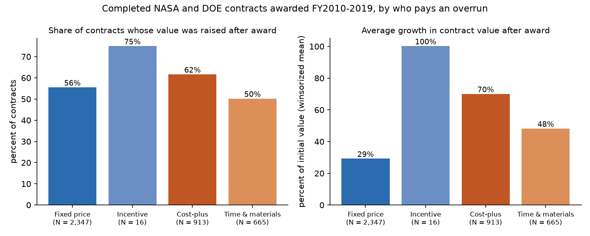
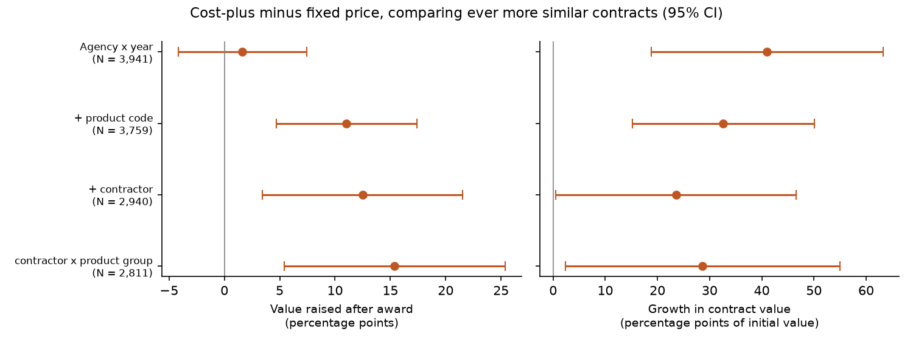

# Fixed Price or Cost-Plus

### In 1993, Jean-Jacques Laffont and Jean Tirole worked out how a government should pay a contractor whose costs it can see but whose effort it cannot. I asked whether the contracts NASA and the Department of Energy actually sign behave the way their theory says.

---

When Boeing agreed to fly NASA astronauts to the International Space Station in its Starliner capsule, it agreed to
a fixed price. The program then ran late, and the cost of the delays landed on Boeing. Its annual report for 2024
records a $523 million loss on Commercial Crew that year, on top of $288 million in 2023, and says the
company booked $5.0 billion of additional losses in 2024 on its five most significant fixed-price development programs. On the
government's side of the ledger almost nothing moved. The value of NASA's Starliner mission order, $1,402 million when
it was signed in December 2016, stood at $1,436 million in the federal contract records I downloaded, a change of
2.5%.

Over the same years Aerojet Rocketdyne was restarting production for NASA of the RS-25, the shuttle-era engine that
powers the Space Launch System. That contract was cost-plus-award-fee, meaning NASA reimburses the contractor's
allowable costs and adds a fee. It was signed in November 2015 at $1,167 million. Its value is now $4,144 million.

Those two contracts are the two ends of a dial that every government buyer turns. Turn it toward fixed price and
the contractor keeps every dollar it saves and pays every dollar it overruns. Turn it toward cost-plus and the
taxpayer does. Jean-Jacques Laffont and Jean Tirole built the theory of where to set that dial, and it was the first
contribution the Royal Swedish Academy of Sciences described when it gave Tirole the Nobel Prize. This repository
takes their sharpest prediction to the 3,941 completed NASA and Energy Department contracts of $1 million or more
awarded between fiscal 2010 and 2019.

---

## Who pays for an overrun

Every federal contract records its pricing type, and the types line up by one number, the share of a cost overrun
the government pays. I'll call it $`b`$. A contract signed for an expected cost $`c^a`$ that ends up costing $`C`$ pays
the contractor a fixed amount $`a`$ plus the government's share of the difference:

```math
G = a + b\,(C - c^a), \qquad 0 \le b \le 1 .
```

Here $`G`$ is the government's total payment. Under a firm fixed price, $`b = 0`$ and the payment is $`a`$ whatever
happens. Under cost-plus, $`b = 1`$ and every dollar of overrun is passed to the government. Incentive contracts sit in
between, splitting overruns by a negotiated share ratio.

| Contract type | Government's share of an overrun, $`b`$ | Example in this study |
|---|---|---|
| Firm fixed price | 0 | Boeing and SpaceX crew flights to the space station |
| Incentive fee (fixed-price or cost-plus) | between 0 and 1 | Fluor Idaho's core contract for the Idaho Cleanup Project |
| Cost-plus (award fee, fixed fee, no fee) | 1 | Aerojet Rocketdyne's RS-25 engines; Triad's operation of Los Alamos |

What I measure is how far a contract's value moves after it is signed. With $`V_0`$ the value written into the
original award, counting every option the government could exercise, and $`V_T`$ the value after every later
modification,

```math
g = \frac{V_T - V_0}{V_0}.
```

For the RS-25 contract that is

```math
g = \frac{4{,}143.5 - 1{,}166.8}{1{,}166.8} = 2.551 ,
```

a 255.1% increase. Including the options in $`V_0`$ matters, because it means exercising a planned option is not
counted as growth. Only modifications that raise the agreed value beyond what was on the table at signing are.

---

## Two economists from Toulouse

Jean-Jacques Laffont was born in Toulouse in 1947 and became a professor at the university there. In the early
1990s he founded the Institut d'Économie Industrielle (IDEI), the research institute where Jean Tirole, born in
Troyes in 1953 and trained at MIT, would become scientific director. Their papers on regulation from 1986 onward were
gathered into a book of more than 700 pages, *A Theory of Incentives in Procurement and Regulation*, published by MIT
Press in 1993. Laffont died in May 2004, at 57. When the Royal Swedish Academy of Sciences gave Tirole the 2014
prize "for his analysis of market power and regulation," its scientific background described the 1993 book as "encyclopedic" and noted that Laffont had "passed away much too young."

The book's starting point is a government buying something from a firm. The firm's cost is

```math
C = \beta - e ,
```

where $`\beta`$ is how efficient the firm is to begin with and $`e`$ is the effort its managers put into cutting cost.
Effort is unpleasant, with a cost to the managers of $`\psi(e)`$ that rises faster than effort does. The government
sees the bill $`C`$ but cannot see $`\beta`$ or $`e`$ separately, so it cannot tell a hard-working inefficient firm from a
lazy efficient one.

The incentive half of the argument takes four lines. Assume the firm keeps whatever the government pays above its
cost, minus the managers' disutility of effort, and that it chooses effort after signing a contract with share
$`b`$. To make the argument quantitative, give effort the simplest convex cost, $`\psi(e) = e^2/2k`$, and suppose the
expected cost written into the contract, $`c^a`$, is what the firm would spend if it worked as hard as a fixed-price
contractor would, $`\beta - k`$.

```math
\begin{aligned}
\max_e\;\; & a + b\,(\beta - e - c^a) - (\beta - e) - \psi(e) \\
\Rightarrow\;\; & \psi'(e) = 1 - b \;\;\Rightarrow\;\; e(b) = k\,(1 - b) \\
\mathbb{E}[C - c^a] \;=\; & k - k\,(1 - b) \;=\; k\,b \\
\mathbb{E}[G - a] \;=\; & b \cdot k\,b \;=\; k\,b^2
\end{aligned}
```

In words, every point of overrun the government agrees to absorb cuts the contractor's effort, so the government
pays a larger share of a larger overrun, and its expected extra payment rises with the square of its share. If cost
also carries an unforeseeable shock $`\varepsilon`$ with variance $`\sigma^2`$, the extra payment varies with
$`b^2\sigma^2`$, so cost-plus bills should also be far more spread out.

Laffont and Tirole's deeper result is why the government does not simply set $`b = 0`$ for everyone. A fixed price
high enough to keep inefficient firms willing to bid hands efficient firms a large windfall, which taxpayers fund.
The optimal arrangement is a menu. The most efficient firm takes a fixed-price contract and works as hard as it
should; less efficient firms choose contracts with higher $`b`$, work less hard, and earn smaller windfalls. The
Academy's background paper calls this "no distortion at the top." It also means firms sort themselves, which is the
strongest objection to any test like mine, and one the committee raised itself in a footnote. If efficient firms pick
fixed-price contracts, fixed-price contracts will look cheaper even if the contract type itself changes nothing.
Patrick Bajari and Steven Tadelis pressed a related point in 2001. Cost-plus, they argued, is chosen for complex work
whose design is likely to change, because renegotiating a fixed price every time the plans change is expensive.

The question still matters because the choice between fixed price and cost-plus is argued over again every time a
big federal program slips.

---

## How I tested it

I downloaded every contract action recorded for NASA and the Department of Energy in the USAspending award data
archive (the October 2026 release), fiscal 2008 through 2026, and rebuilt each contract's history from its original
award through its last modification. I kept contracts first awarded in fiscal 2010 through 2019 with an initial value,
options included, of at least $1 million, whose period of performance had ended by September 2025, so that each one
had run its course. I dropped indefinite-delivery umbrella agreements (the orders placed under them stay in), letter
contracts whose price had not been agreed at award, and the task orders under NASA's sponsoring agreements with
Caltech for the Jet Propulsion Laboratory (all three successive agreements), which record each year's funding
as the order's value. That leaves 3,941 contracts with 1,431 contractors, worth $64 billion at signing.

The book never states a regression, so the test is the comparison its incentive result implies. I grouped the ten
pricing codes into four tiers by the government's share of overruns and compared three outcomes, whether the value
was raised at all after award, whether total obligations ended above the initial value, and the growth $`g`$ itself,
winsorized at the 1st and 99th percentiles (values beyond them are set to the cutoff). The estimating equation for contract $`i`$ is

```math
\begin{aligned}
y_i = {} & \sum_{k} \beta_k\, D_{ik} + \gamma \ln V_{0i} + \alpha_{a(i),t(i)} + \delta_{\tau(i)} \\
         & + \mu_{p(i)} + \eta_{f(i)} + \varepsilon_i ,
\end{aligned}
```

where $`D_{ik}`$ marks the incentive, cost-plus and time-and-materials tiers (fixed price is the base), $`\alpha`$ is an
agency-by-award-year effect, $`\delta`$ an award-type effect, $`\mu`$ a product-or-service-code effect and $`\eta`$ a
contractor effect. The null hypothesis is $`\beta_{\text{cost-plus}} = 0`$. Standard errors are clustered by
contractor parent company. I add $`\mu`$ and then $`\eta`$ one at a time, and in a last step replace $`\eta`$ with a contractor effect
specific to R&D, products or services. Contracts left alone in a fixed-effect group carry no comparison and are
dropped. That ladder is the extension. If
the gap is all about what is bought and who sells it, it should shrink toward zero as the comparison narrows to
the same product code and the same company.

---

## Cost-plus contracts grow more, and their growth is far more spread out

| Tier | Contracts | Value at signing | Value raised after award | Median growth | Mean growth (winsorized) | Growth in total dollars |
|---|---|---|---|---|---|---|
| Fixed price | 2,347 | $17.5 billion | 55% | 1.85% | 29% | 25% |
| Incentive | 16 | $6.9 billion | 75% | 24% | 100% | 46% |
| Cost-plus | 913 | $34.8 billion | 62% | 8.3% | 70% | 64% |
| Time and materials | 665 | $5.0 billion | 50% | 0.1% | 48% | 39% |



Taken in total dollars, the fixed-price contracts that were signed for $17.5 billion ended at $21.9 billion, and the
cost-plus contracts signed for $34.8 billion ended at $57.0 billion. For every $100 promised at signing, the
government ended up committed to about $125 on a fixed-price contract and about $164 on a cost-plus one.

The spread is the clearest result. The standard deviation of growth is 100 percentage points for fixed-price
contracts and 168 for cost-plus, a variance ratio of 2.9, and a Brown-Forsythe test rejects equal spreads with a
statistic of 80.3 (p < 0.001). That is what the $`b^2\sigma^2`$ term in the derivation predicts, and it shows up
without any regression.

In the regression with only agency-by-year, award-type and size controls,

```math
\hat\beta_{\text{cost-plus}}^{\,g} = 41.0 \;(11.3),\quad 95\%\ \text{CI}\ [18.8,\ 63.2],\quad N = 3{,}941 ,
```

in percentage points of initial value. The same specification gives almost no difference in the probability that
the value is raised at all, 1.6 points (standard error 3.0). Across all contracts, cost-plus and fixed-price contracts
are modified upward about equally often. The cost-plus ones are modified upward by more.

The incentive tier does not sit between the other two as the theory would have it. It holds only 16 contracts, 12
of them cost-plus-incentive-fee, and its estimates have standard errors of 9 to 57 points, so the data say very
little about it either way. Treating the three tiers as ranked 0, 1, 2 gives a slope of 20.9 points of growth per
step (standard error 5.7) and no slope at all for the two yes-or-no outcomes.

---

## For the same contractor and the same kind of work, cost-plus contracts still grow more often

If Bajari and Tadelis were right that cost-plus is simply where the hard, changeable work goes, adding product codes
and contractors to the comparison should drain the gap. It drains part of it and widens another part.

| Comparison | Value raised (points) | Overspent initial value (points) | Growth (points of initial value) | Contracts |
|---|---|---|---|---|
| Agency and year only | 1.6 (3.0) | 0.3 (3.1) | 41.0 (11.3) | 3,941 |
| Same product code | 11.0 (3.2) | 10.3 (3.2) | 32.6 (8.9) | 3,759 |
| Same product code and contractor | 12.5 (4.6) | 11.7 (4.8) | 23.6 (11.8) | 2,940 |
| Same contractor within R&D, products or services | 15.4 (5.1) | 13.9 (5.3) | 28.7 (13.4) | 2,811 |

*Cost-plus minus fixed price, standard errors clustered by contractor in parentheses. A contract that is alone in
its product code or contractor group offers no comparison and drops out, which is why the count falls.*



The size of the growth gap falls by 30 to 42 percent once the comparison is within product code and contractor, from
41 points to 24 to 29, and becomes much less precise. In the narrowest comparison its 95% interval runs from 2 to 55.
That part of the raw difference is composition, the kind of work and the kind of company. For the same contractor
doing the same kind of work,

```math
\hat\beta_{\text{cost-plus}}^{\,\text{raised}} = 15.4 \;(5.1),\quad 95\%\ \text{CI}\ [5.4,\ 25.4],\quad N = 2{,}811 .
```

The yes-or-no gap goes the other way, rising from 2 points to 11, then 12, then 15. The reason is visible in the raw tables.
Of the 2,347 fixed-price contracts, 1,584 are for services, and service contracts are extended and expanded often.
Sixty-three percent of fixed-price service contracts had their value raised. Once each contract is compared only with others
for the same product code, the cost-plus version is the one more likely to grow. Within research and development,
57% of cost-plus contracts were raised against 40% of fixed-price ones, and for physical products 70% against 40%.

So selection on what is bought cuts both ways here. It was hiding part of the cost-plus effect on how often a
contract grows, and inflating part of its effect on how much.

---

## Nearly three of every four of the biggest contracts are cost-plus

NASA and the Energy Department signed 30 contracts of $500 million or more in fiscal 2010 to 2019 that were not
later cancelled, leaving aside the Jet Propulsion Laboratory orders. Twenty-two are cost-plus, three more are
cost-plus-incentive-fee, four are firm fixed price and one is fixed price incentive.

| Contract | Contractor | Type | Signed | Value at signing | Value now | Change |
|---|---|---|---|---|---|---|
| Sandia National Laboratories | National Technology & Engineering Solutions of Sandia | Cost plus fixed fee | 2016 | $26.5 billion | $56.1 billion | +112% |
| Los Alamos National Laboratory | Triad National Security | Cost plus award fee | 2018 | $24.0 billion | $48.7 billion | +103% |
| Y-12 and Pantex nuclear weapons plants | Consolidated Nuclear Security | Cost plus award fee | 2013 | $22.8 billion | $54.1 billion | +137% |
| Kansas City National Security Campus | Honeywell | Cost plus award fee | 2015 | $6.9 billion | $21.9 billion | +218% |
| RS-25 engines for the Space Launch System | Aerojet Rocketdyne | Cost plus award fee | 2015 | $1.17 billion | $4.14 billion | +255% |
| Portsmouth gaseous diffusion plant cleanup | Fluor-BWXT | Cost plus award fee | 2010 | $2.08 billion | $6.03 billion | +190% |
| Commercial crew flights | SpaceX | Firm fixed price | 2016 | $0.89 billion | $3.77 billion | +325% |
| Commercial crew flights | Boeing | Firm fixed price | 2016 | $1.40 billion | $1.44 billion | +2% |
| Naval reactor cores | BWXT | Fixed price incentive | 2014 | $0.53 billion | $0.52 billion | −1% |

*All 30 are in `results/named_contracts.csv`. Many are still running, so their values are to date.*

The SpaceX line shows how a fixed-price contract grows. NASA bought more flights, so the order grew because the
scope grew, while Boeing's order, for the same service under the same terms, barely moved even as Boeing absorbed
the cost of its delays. The weapons laboratories at the top of the table are a different kind of contract. They
are management-and-operating contracts for government-owned sites, every one of them cost-plus here, and their
values grow as new work is assigned to the sites. The theory's prediction about effort applies to them, but their
growth mixes overrun with new work in a way these records cannot separate.

---

## Why it matters

For taxpayers, the numbers say the price on a cost-plus contract at signing is a much weaker promise than the price
on a fixed-price one. Over a decade of completed NASA and Energy contracts, $100 of cost-plus commitments at signing
became about $164, against about $125 for fixed price, and the cost-plus outcomes were far less predictable.

For the companies, fixed price moves the risk onto their own books, which is exactly what Laffont and Tirole's model
says it should do. Boeing's Starliner losses are that risk arriving. A contractor that expects to be inefficient, or
expects the design to change, has every reason to prefer cost-plus, and the theory says the government should let
some of them have it.

For the people who run programs, the within-contractor result is the useful one. The same company, doing the same
kind of work, was about 15 points more likely to see its contract value raised when the government had agreed to
reimburse its costs. That gap is a cost of choosing cost-plus that ought to be priced in when the choice is made.

For policy, the result supports neither blanket position. Cost-plus contracts do grow more, for the same contractor
selling the same kind of thing, as the theory predicts. But a third or more of the raw growth gap is composition, and the theory itself
says a menu with some cost-plus in it beats fixed price for everyone. The argument worth having about a big program
is whether the firm and the work are the kind for which a fixed price is credible.

---

## Limits of this study

Contract value is not cost. For cost-plus contracts the recorded value tracks the government's reimbursement, which
is close to the contractor's cost, but for fixed-price contracts the contractor's actual cost never appears in these
records, so a Starliner overrun is invisible here except through Boeing's own filings. Value growth also mixes true
overruns with new scope, and federal records do not reliably separate the two. Pricing type is chosen, so even the
within-contractor comparison cannot rule out that firms put their riskier projects on cost-plus terms. The incentive
tier is too small to test the theory's prediction for intermediate shares. Requiring a contract to have finished drops the
long-running ones, and because extensions add value, the awards from late in the decade that made it into the
sample lean toward contracts that did not grow much. The study covers two agencies whose
purchases lean toward research and site operations and leaves out the Defense Department, by far the largest
buyer, whose contract archives dwarf these two agencies' combined. And the effort channel cannot be separated from
the government simply paying its share of shocks, since both raise growth under cost-plus.

---

## Further reading

- [TECHNICAL.md](TECHNICAL.md) has the data, method, every test statistic and how to reproduce the results.
- [results/FINDINGS.md](results/FINDINGS.md) summarizes the findings and contains every table the scripts produce.
- [METHODS_REVIEW.md](METHODS_REVIEW.md) is a methods review of the original book.
- The original work is Jean-Jacques Laffont and Jean Tirole, *A Theory of Incentives in Procurement and Regulation*,
  MIT Press, 1993. The model is summarized in the Royal Swedish Academy of Sciences, *Scientific Background on the
  Sveriges Riksbank Prize in Economic Sciences in Memory of Alfred Nobel 2014: Jean Tirole, Market Power and
  Regulation* (13 October 2014).
- Contract data come from the USAspending award data archive, `files.usaspending.gov/award_data_archive/`, release
  of 6 October 2026, NASA (agency 080) and Department of Energy (agency 089) "Contracts_Full" files, fiscal 2008
  to 2026, downloaded 1 November 2026.
- Boeing's Commercial Crew losses are from The Boeing Company, Form 10-K for fiscal 2024, filed with the SEC on
  3 February 2025.
- Patrick Bajari and Steven Tadelis, "Incentives versus Transaction Costs: A Theory of Procurement Contracts," *RAND
  Journal of Economics* 32(3), 2001.

*Brendyn Beasley*
