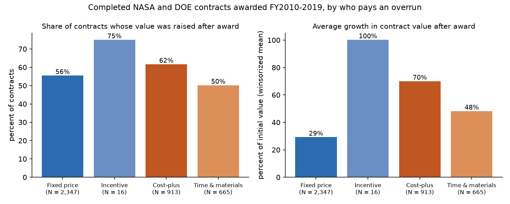
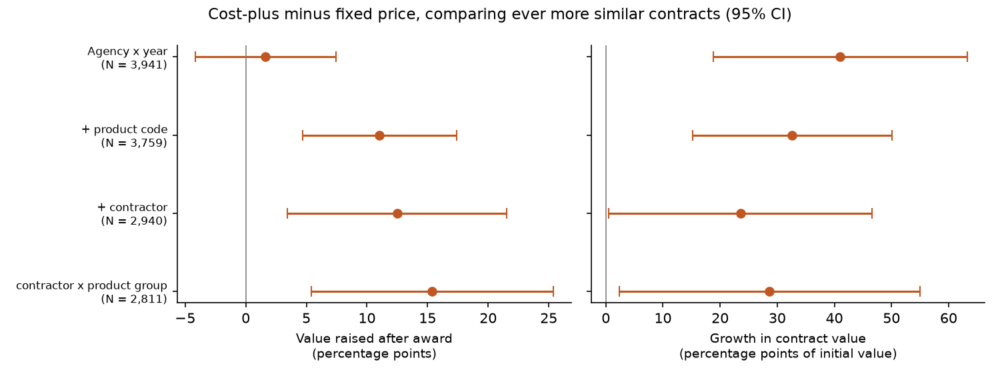

# Laffont and Tirole (1993) on NASA and DOE contracts: findings

## In plain English

Laffont and Tirole's theory says that the more of a cost overrun the government agrees to pay, the less hard a
contractor works to avoid one, so cost-plus contracts should end up costing more relative to their signed price than
fixed-price ones, and should be less predictable. This study checks that against 3,941 completed NASA and Department
of Energy contracts of $1 million or more awarded in fiscal 2010 to 2019.

- **Cost-plus contracts grow more.** For every $100 agreed at signing, completed cost-plus contracts ended at about
  $164 and fixed-price contracts at about $125. The biggest cost-plus contracts in the data, such as Aerojet
  Rocketdyne's RS-25 engines for NASA's Space Launch System (up 255%) and the operating contracts for Los Alamos
  (Triad National Security, up 103% so far) and the Y-12 and Pantex plants (Consolidated Nuclear Security, up 137%),
  show the pattern at scale.
- **Their outcomes are far more spread out.** The variance of growth is 2.9 times larger for cost-plus than for
  fixed-price contracts, which is what the theory predicts when the government absorbs cost shocks.
- **The gap survives comparing like with like.** For the same contractor doing the same kind of work, a cost-plus
  contract is about 15 percentage points more likely to have its value raised. The gap in how much contracts grow
  shrinks by 30 to 42 percent in that comparison, so part of the raw gap is about what is bought and who sells it.
- **Fixed price moves the risk, it does not remove it.** Boeing's fixed-price Starliner order with NASA grew 2.5%
  while Boeing reported $523 million of Commercial Crew losses in 2024 alone (its 10-K, not these data). SpaceX's
  fixed-price order grew 325% because NASA bought more flights.

A fuller account is in the [README](../README.md); methods and test statistics are in
[TECHNICAL.md](../TECHNICAL.md).

## Key to the labels

*Tier* groups FPDS pricing codes by the government's share of an overrun: fixed price (J, K, M), incentive (L, V),
cost-plus (R, U, S), time and materials (Y, Z). *Initial value* is the base-and-all-options value on the original
award; *final value* adds every later modification. *Raised* = final value above initial value. *Overspent* = total
obligations above initial value. *Growth* = (final − initial) / initial; *mean growth* and *sd growth* use growth winsorized at the 1st and
99th percentiles, and *dollar growth* is total final value over total initial value minus one. *Product group* is R&D
(product or service code starting with A), products (numeric codes) or services (other letters). Regression
coefficients are cost-plus (or incentive, or time and materials) minus fixed price, in percentage points, with
standard errors clustered by contractor parent; specifications add fixed effects as named in the *spec* column.
In `named_contracts.csv`, values are in millions of dollars and are to date for contracts still running.

## Figures

## Every table

### `results/sample_summary.csv`

| contracts | contractors | initial_value_bn | nasa | doe | share_fixed_price_pct | share_cost_plus_pct | winsor_lo | winsor_hi |
|---|---|---|---|---|---|---|---|---|
| 3,941 | 1,431 | 64.14 | 2,250 | 1,691 | 59.55 | 23.17 | -0.715 | 8.656 |

### `results/growth_by_tier.csv`

| tier | contracts | initial_value_bn | final_value_bn | share_raised_pct | share_overspent_pct | mean_growth_pct | median_growth_pct | p90_growth_pct | sd_growth_pct | dollar_growth_pct |
|---|---|---|---|---|---|---|---|---|---|---|
| Fixed price | 2,347 | 17.47 | 21.87 | 55.52 | 47.21 | 29.24 | 1.85 | 72.95 | 99.77 | 25.20 |
| Incentive | 16 | 6.85 | 10.03 | 75.00 | 62.50 | 100.21 | 23.63 | 219.61 | 203.89 | 46.48 |
| Cost-plus | 913 | 34.81 | 57.04 | 61.66 | 52.90 | 70.04 | 8.34 | 214.06 | 168.48 | 63.84 |
| Time and materials | 665 | 5.01 | 6.94 | 50.23 | 36.09 | 48.26 | 0.14 | 142.50 | 143.14 | 38.58 |

### `results/growth_by_pricing_code.csv`

| pricing | pricing_type | tier | contracts | initial_value_bn | final_value_bn | share_raised_pct | share_overspent_pct | mean_growth_pct | median_growth_pct | p90_growth_pct | sd_growth_pct | dollar_growth_pct |
|---|---|---|---|---|---|---|---|---|---|---|---|---|
| J | Firm fixed price | Fixed price | 2,310 | 17.14 | 21.34 | 55.84 | 47.53 | 29.08 | 1.88 | 71.88 | 99.49 | 24.52 |
| U | Cost plus fixed fee | Cost-plus | 691 | 14.88 | 22.35 | 61.65 | 52.68 | 78.59 | 8.34 | 269.18 | 182.38 | 50.17 |
| Y | Time and materials | Time and materials | 504 | 3.83 | 5.38 | 45.83 | 35.12 | 48.10 | 0.00 | 170.56 | 148.43 | 40.68 |
| Z | Labor hours | Time and materials | 161 | 1.18 | 1.56 | 63.98 | 39.13 | 48.76 | 11.56 | 114.40 | 125.56 | 31.77 |
| R | Cost plus award fee | Cost-plus | 141 | 18.95 | 33.58 | 73.76 | 65.25 | 49.37 | 21.42 | 121.03 | 97.56 | 77.27 |
| S | Cost, no fee | Cost-plus | 81 | 0.98 | 1.10 | 40.74 | 33.33 | 33.05 | 0.00 | 32.35 | 131.42 | 12.16 |
| K | Fixed price, economic price adjustment | Fixed price | 33 | 0.24 | 0.26 | 27.27 | 18.18 | 20.03 | -0.00 | 67.76 | 92.86 | 6.34 |
| V | Cost plus incentive fee | Incentive | 12 | 5.69 | 8.72 | 83.33 | 75.00 | 122.12 | 36.56 | 282.36 | 230.89 | 53.21 |
| L | Fixed price incentive | Incentive | 4 | 1.16 | 1.32 | 50.00 | 25.00 | 34.49 | 0.93 | 96.67 | 68.55 | 13.49 |
| M | Fixed price award fee | Fixed price | 4 | 0.09 | 0.28 | 100.00 | 100.00 | 196.86 | 198.88 | 365.10 | 188.99 | 197.78 |

### `results/growth_by_agency_tier.csv`

| agency | tier | contracts | initial_value_bn | final_value_bn | share_raised_pct | share_overspent_pct | mean_growth_pct | median_growth_pct | p90_growth_pct | sd_growth_pct | dollar_growth_pct |
|---|---|---|---|---|---|---|---|---|---|---|---|
| DOE | Cost-plus | 229 | 13.02 | 26.13 | 68.56 | 58.52 | 83.80 | 16.78 | 277.66 | 193.46 | 100.66 |
| DOE | Fixed price | 867 | 5.16 | 6.89 | 55.25 | 38.64 | 25.95 | 1.39 | 69.20 | 96.04 | 33.68 |
| DOE | Incentive | 6 | 5.45 | 8.09 | 83.33 | 50.00 | 93.02 | 59.12 | 219.61 | 114.36 | 48.51 |
| DOE | Time and materials | 589 | 4.76 | 6.49 | 49.75 | 35.31 | 45.12 | 0.00 | 125.39 | 138.96 | 36.43 |
| NASA | Cost-plus | 684 | 21.79 | 30.91 | 59.36 | 51.02 | 65.43 | 5.57 | 175.64 | 159.14 | 41.85 |
| NASA | Fixed price | 1,480 | 12.31 | 14.98 | 55.68 | 52.23 | 31.16 | 2.14 | 73.58 | 101.87 | 21.64 |
| NASA | Incentive | 10 | 1.40 | 1.94 | 70.00 | 70.00 | 104.52 | 14.07 | 176.26 | 248.92 | 38.58 |
| NASA | Time and materials | 76 | 0.25 | 0.45 | 53.95 | 42.11 | 72.63 | 2.06 | 204.16 | 171.22 | 79.66 |

### `results/growth_by_category_tier.csv`

| psc_group | tier | contracts | initial_value_bn | final_value_bn | share_raised_pct | share_overspent_pct | mean_growth_pct | median_growth_pct | p90_growth_pct | sd_growth_pct | dollar_growth_pct |
|---|---|---|---|---|---|---|---|---|---|---|---|
| Product | Cost-plus | 44 | 0.59 | 0.76 | 70.45 | 59.09 | 37.68 | 20.20 | 109.28 | 63.22 | 28.72 |
| Product | Fixed price | 476 | 2.36 | 3.09 | 39.50 | 31.93 | 17.91 | 0.00 | 30.59 | 83.18 | 30.93 |
| Product | Incentive | 5 | 0.96 | 1.13 | 80.00 | 60.00 | 43.37 | 3.07 | 112.71 | 61.66 | 18.28 |
| Product | Time and materials | 18 | 0.09 | 0.11 | 22.22 | 0.00 | 19.86 | 0.00 | 29.64 | 96.02 | 27.13 |
| R&D | Cost-plus | 427 | 8.93 | 13.19 | 56.67 | 48.71 | 63.98 | 3.64 | 173.94 | 165.15 | 47.80 |
| R&D | Fixed price | 287 | 1.32 | 1.89 | 40.42 | 36.59 | 34.38 | 0.00 | 74.88 | 127.22 | 42.95 |
| R&D | Incentive | 1 | 0.31 | 0.31 | 0.00 | 0.00 | 0.00 | 0.00 | 0.00 |  | 0.00 |
| R&D | Time and materials | 6 | 0.01 | 0.02 | 50.00 | 50.00 | 43.14 | 9.04 | 123.08 | 62.47 | 25.61 |
| Service | Cost-plus | 442 | 25.30 | 43.09 | 65.61 | 56.33 | 79.11 | 14.14 | 252.86 | 178.17 | 70.32 |
| Service | Fixed price | 1,584 | 13.78 | 16.89 | 63.07 | 53.72 | 31.71 | 5.27 | 80.37 | 98.50 | 22.51 |
| Service | Incentive | 10 | 5.58 | 8.59 | 80.00 | 70.00 | 138.65 | 36.56 | 352.27 | 251.08 | 53.90 |
| Service | Time and materials | 641 | 4.90 | 6.81 | 51.01 | 36.97 | 49.11 | 0.52 | 144.50 | 144.77 | 38.83 |

### `results/regressions.csv`

| spec | outcome | tier | coef | se | ci_lo | ci_hi | p | n | clusters |
|---|---|---|---|---|---|---|---|---|---|
| 1 Agency x year | raised | Incentive | 2.64 | 9.08 | -15.16 | 20.45 | 0.7712 | 3,941 | 1,431 |
| 1 Agency x year | raised | Cost-plus | 1.63 | 2.96 | -4.18 | 7.44 | 0.5820 | 3,941 | 1,431 |
| 1 Agency x year | raised | Time and materials | -6.21 | 3.18 | -12.44 | 0.02 | 0.0509 | 3,941 | 1,431 |
| 2 + product code | raised | Incentive | 11.20 | 12.63 | -13.55 | 35.94 | 0.3753 | 3,759 | 1,334 |
| 2 + product code | raised | Cost-plus | 11.05 | 3.25 | 4.68 | 17.42 | 0.0007 | 3,759 | 1,334 |
| 2 + product code | raised | Time and materials | -0.25 | 3.27 | -6.65 | 6.16 | 0.9398 | 3,759 | 1,334 |
| 3 + contractor | raised | Incentive | 9.85 | 15.71 | -20.94 | 40.63 | 0.5308 | 2,940 | 554 |
| 3 + contractor | raised | Cost-plus | 12.49 | 4.63 | 3.42 | 21.55 | 0.0070 | 2,940 | 554 |
| 3 + contractor | raised | Time and materials | 2.67 | 4.09 | -5.35 | 10.68 | 0.5145 | 2,940 | 554 |
| 4 contractor x product group | raised | Incentive | 15.61 | 16.09 | -15.92 | 47.15 | 0.3318 | 2,811 | 520 |
| 4 contractor x product group | raised | Cost-plus | 15.39 | 5.10 | 5.40 | 25.37 | 0.0025 | 2,811 | 520 |
| 4 contractor x product group | raised | Time and materials | 1.04 | 4.09 | -6.98 | 9.05 | 0.7997 | 2,811 | 520 |
| 1 Agency x year | overspent | Incentive | 5.04 | 10.82 | -16.16 | 26.25 | 0.6412 | 3,941 | 1,431 |
| 1 Agency x year | overspent | Cost-plus | 0.34 | 3.11 | -5.76 | 6.45 | 0.9126 | 3,941 | 1,431 |
| 1 Agency x year | overspent | Time and materials | -7.88 | 3.10 | -13.96 | -1.80 | 0.0111 | 3,941 | 1,431 |
| 2 + product code | overspent | Incentive | 19.54 | 12.31 | -4.59 | 43.66 | 0.1125 | 3,759 | 1,334 |
| 2 + product code | overspent | Cost-plus | 10.32 | 3.20 | 4.05 | 16.59 | 0.0013 | 3,759 | 1,334 |
| 2 + product code | overspent | Time and materials | -4.04 | 3.25 | -10.41 | 2.33 | 0.2140 | 3,759 | 1,334 |
| 3 + contractor | overspent | Incentive | 13.41 | 17.67 | -21.21 | 48.04 | 0.4477 | 2,940 | 554 |
| 3 + contractor | overspent | Cost-plus | 11.73 | 4.77 | 2.38 | 21.08 | 0.0139 | 2,940 | 554 |
| 3 + contractor | overspent | Time and materials | 0.57 | 4.01 | -7.28 | 8.42 | 0.8868 | 2,940 | 554 |
| 4 contractor x product group | overspent | Incentive | 24.30 | 18.26 | -11.50 | 60.09 | 0.1834 | 2,811 | 520 |
| 4 contractor x product group | overspent | Cost-plus | 13.94 | 5.28 | 3.58 | 24.29 | 0.0083 | 2,811 | 520 |
| 4 contractor x product group | overspent | Time and materials | 0.02 | 4.07 | -7.96 | 8.00 | 0.9960 | 2,811 | 520 |
| 1 Agency x year | growth_w | Incentive | 85.47 | 40.44 | 6.20 | 164.73 | 0.0346 | 3,941 | 1,431 |
| 1 Agency x year | growth_w | Cost-plus | 41.03 | 11.33 | 18.83 | 63.23 | 0.0003 | 3,941 | 1,431 |
| 1 Agency x year | growth_w | Time and materials | 15.43 | 8.76 | -1.74 | 32.60 | 0.0781 | 3,941 | 1,431 |
| 2 + product code | growth_w | Incentive | 21.93 | 38.30 | -53.13 | 97.00 | 0.5669 | 3,759 | 1,334 |
| 2 + product code | growth_w | Cost-plus | 32.63 | 8.92 | 15.16 | 50.11 | 0.0003 | 3,759 | 1,334 |
| 2 + product code | growth_w | Time and materials | 12.85 | 8.29 | -3.39 | 29.10 | 0.1210 | 3,759 | 1,334 |
| 3 + contractor | growth_w | Incentive | -71.24 | 54.82 | -178.68 | 36.20 | 0.1938 | 2,940 | 554 |
| 3 + contractor | growth_w | Cost-plus | 23.59 | 11.75 | 0.55 | 46.63 | 0.0448 | 2,940 | 554 |
| 3 + contractor | growth_w | Time and materials | 6.20 | 10.68 | -14.73 | 27.14 | 0.5614 | 2,940 | 554 |
| 4 contractor x product group | growth_w | Incentive | -67.41 | 56.55 | -178.25 | 43.44 | 0.2333 | 2,811 | 520 |
| 4 contractor x product group | growth_w | Cost-plus | 28.67 | 13.43 | 2.35 | 54.99 | 0.0328 | 2,811 | 520 |
| 4 contractor x product group | growth_w | Time and materials | 6.24 | 10.85 | -15.03 | 27.52 | 0.5650 | 2,811 | 520 |

### `results/power_trend.csv`

| outcome | slope_per_rank | se | ci_lo | ci_hi | p | n |
|---|---|---|---|---|---|---|
| raised | 0.71 | 1.51 | -2.25 | 3.67 | 0.6392 | 3,276 |
| overspent | -0.18 | 1.58 | -3.28 | 2.91 | 0.9069 | 3,276 |
| growth_w | 20.91 | 5.75 | 9.65 | 32.18 | 0.0003 | 3,276 |

### `results/variance_test.csv`

| test | statistic | p | sd_fixed_pct | sd_costplus_pct | variance_ratio |
|---|---|---|---|---|---|
| Brown-Forsythe, all four tiers | 29.68 | 0.0000 | 99.77 | 168.48 | 2.85 |
| Brown-Forsythe, fixed price vs cost-plus | 80.29 | 0.0000 | 99.77 | 168.48 | 2.85 |

### `results/worked_example.csv`

| tier | piid | recipient | agency | initial_value | final_value | obligated | growth_pct |
|---|---|---|---|---|---|---|---|
| Fixed price | NNM13AB15D | MADISON ELECTRIC INC | NASA | 2,285,300.00 | 2,272,372.00 | 2,272,372.00 | -0.57 |
| Cost-plus | DEDT0009783 | APPSENTIAL LLC | DOE | 3,705,562.92 | 2,956,695.42 | 2,955,095.42 | -20.21 |

### `results/named_contracts.csv` (selected columns; descriptions are in the CSV)

| agency | piid | recipient | pricing_type | award_date | initial_value_m | final_value_m | obligated_m | growth_pct | n_mods |
|---|---|---|---|---|---|---|---|---|---|
| DOE | DENA0003525 | NATIONAL TECHNOLOGY & ENGINEERING SOLUTIONS OF SANDIA, LLC | Cost plus fixed fee | 2016-12-16 | 26,499.8 | 56,061.3 | 43,460.7 | 111.6 | 312 |
| DOE | 89233218CNA000001 | TRIAD NATIONAL SECURITY, LLC | Cost plus award fee | 2018-06-08 | 23,999.9 | 48,677.4 | 35,413.6 | 102.8 | 261 |
| DOE | DENA0001942 | CONSOLIDATED NUCLEAR SECURITY, LLC | Cost plus award fee | 2013-01-08 | 22,790.2 | 54,056.7 | 34,661.8 | 137.2 | 406 |
| DOE | 89233018CNR000004 | FLUOR MARINE PROPULSION, LLC | Cost plus fixed fee | 2018-07-12 | 17,000.2 | 18,500.2 | 14,754.1 | 8.8 | 150 |
| DOE | DENA0002839 | HONEYWELL FEDERAL MANUFACTURING & TECHNOLOGIES, LLC | Cost plus award fee | 2015-07-09 | 6,882.4 | 21,874.3 | 17,732.2 | 217.8 | 302 |
| DOE | DENA0003624 | MISSION SUPPORT & TEST SERVICES LLC | Cost plus award fee | 2017-05-12 | 5,294.9 | 11,299.0 | 7,708.7 | 113.4 | 319 |
| DOE | DENA0000622 | HONEYWELL FEDERAL MANUFACTURING & TECHNOLOGIES, LLC | Cost plus incentive fee | 2010-09-30 | 3,102.5 | 4,550.4 | 3,026.5 | 46.7 | 119 |
| NASA | NNX11AA01C | PERATON ENTERPRISE SOLUTIONS LLC | Firm fixed price | 2010-12-27 | 2,500.0 | 2,500.0 | 769.2 | 0.0 | 463 |
| DOE | DESC0004645 | UCOR LLC | Cost plus award fee | 2011-04-29 | 2,239.7 | 4,175.3 | 3,900.8 | 86.4 | 432 |
| DOE | DEAC3010CC40017 | FLUOR-BWXT PORTSMOUTH LLC | Cost plus award fee | 2010-08-16 | 2,079.8 | 6,028.5 | 4,464.8 | 189.9 | 502 |
| NASA | 80GSFC19C0063 | PERATON INC. | Cost plus award fee | 2019-06-27 | 1,800.0 | 1,800.0 | 1,499.8 | 0.0 | 262 |
| DOE | DEFE0011020 | FLUOR FEDERAL PETROLEUM OPERATIONS, LLC | Cost plus award fee | 2013-09-18 | 1,457.6 | 3,365.5 | 2,112.2 | 130.9 | 182 |
| DOE | DEEM0004083 | FLUOR IDAHO LLC | Cost plus incentive fee | 2016-02-04 | 1,403.0 | 2,407.2 | 2,302.4 | 71.6 | 294 |
| NASA | NNK17MA02T | THE BOEING COMPANY | Firm fixed price | 2016-12-30 | 1,402.0 | 1,436.4 | 306.7 | 2.5 | 18 |
| DOE | DESC0014664 | OAK RIDGE ASSOCIATED UNIVERSITIES, INCORPORATED | Cost plus award fee | 2016-03-10 | 1,392.3 | 3,752.3 | 3,248.1 | 169.5 | 495 |
| DOE | DEEM0001971 | AECOM ENERGY & CONSTRUCTION, INC. | Cost plus award fee | 2012-04-19 | 1,333.7 | 2,950.9 | 2,823.7 | 121.3 | 384 |
| NASA | 80MSFC18C0011 | AMENTUM TECHNOLOGY, INC. | Cost plus award fee | 2017-11-21 | 1,205.1 | 2,268.1 | 2,002.0 | 88.2 | 154 |
| NASA | NNM16AA02C | AEROJET ROCKETDYNE OF DE, INC | Cost plus award fee | 2015-11-19 | 1,166.8 | 4,143.5 | 3,384.9 | 255.1 | 173 |
| NASA | 80JSC017C0006 | KBR WYLE SERVICES, LLC | Cost plus award fee | 2017-07-13 | 1,115.2 | 1,114.3 | 1,057.0 | -0.1 | 199 |
| DOE | DEAC3010CC60025 | CENTERRA GROUP, LLC | Cost plus award fee | 2009-10-08 | 989.0 | 1,619.2 | 1,382.7 | 63.7 | 369 |
| NASA | NNK17MA01T | SPACE EXPLORATION TECHNOLOGIES CORP. | Firm fixed price | 2016-12-30 | 885.2 | 3,765.2 | 3,549.2 | 325.4 | 72 |
| NASA | NNK13MA14C | AMENTUM TECHNOLOGY, INC. | Cost plus award fee | 2012-12-17 | 871.7 | 2,107.2 | 2,099.4 | 141.7 | 404 |
| NASA | NNJ10TB01C | HAMILTON SUNDSTRAND SPACE SYSTEMS INTERNATIONAL, INC. | Cost plus award fee | 2010-09-30 | 728.9 | 1,847.3 | 1,507.7 | 153.4 | 424 |
| NASA | NNS15AA77T | SYNCOM SPACE SERVICES LLC | Cost plus incentive fee | 2016-01-28 | 700.0 | 845.8 | 817.4 | 20.8 | 412 |
| NASA | NNM12AA41C | AMENTUM TECHNOLOGY, INC. | Cost plus fixed fee | 2012-05-29 | 639.0 | 789.0 | 712.9 | 23.5 | 131 |
| NASA | NNG10DB04C | GENERAL DYNAMICS C4 SYSTEMS, INC. | Cost plus award fee | 2010-06-17 | 626.2 | 1,316.9 | 1,248.4 | 110.3 | 193 |
| NASA | 80GSFC19F0127 | THE AEROSPACE CORPORATION | Cost plus fixed fee | 2019-09-27 | 621.0 | 305.0 | 141.2 | -50.9 | 112 |
| NASA | NNG17CR69C | SCIENCE APPLICATIONS INTERNATIONAL CORPORATION | Cost plus fixed fee | 2017-05-12 | 620.0 | 1,064.3 | 1,025.8 | 71.7 | 187 |
| DOE | 89233118FNA400023 | SIEMENS GOVERNMENT TECHNOLOGIES INC | Firm fixed price | 2018-09-20 | 554.6 | 555.1 | 0.5 | 0.1 | 20 |
| DOE | DENR00008 | BWXT NUCLEAR OPERATIONS GROUP, INC. | Fixed price incentive | 2014-01-24 | 526.8 | 520.6 | 132.9 | -1.2 | 5 |
